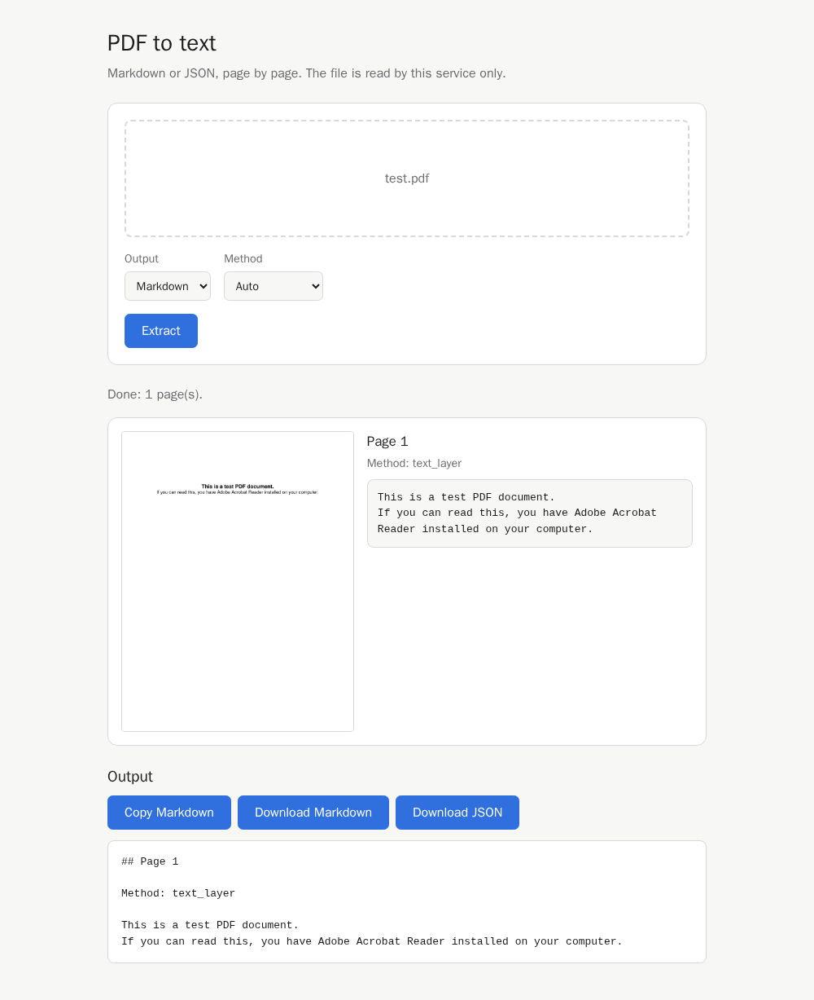

# llm-pdf-ocr-api

[](https://github.com/samestrin/llm-pdf-ocr-api/stargazers)[ ](https://github.com/samestrin/llm-pdf-ocr-api/network/members)[](https://github.com/samestrin/llm-pdf-ocr-api/watchers)

 [ ](https://opensource.org/licenses/MIT)[](https://www.python.org/)

**llm-pdf-ocr-api** is a small FastAPI service that reads a PDF page by page and returns Markdown or JSON. Each page is read the cheapest way that works and the response says which way it was:

- `text_layer`: the PDF's own text, when it has a usable one.
- `tesseract`: OCR with Tesseract, for scanned pages, with a 0 to 1 confidence.
- `vision`: a vision model you point it at (local or in the cloud), if you configure one.

A page that cannot be read is reported as `failed` with a reason; it is never returned as an empty page. Long PDFs can run as jobs with per-page progress.

## Try it

On a fresh clone, with only Docker installed:

```bash
git clone https://github.com/samestrin/llm-pdf-ocr-api
cd llm-pdf-ocr-api
docker compose up --build
```

Open <http://localhost:5000> and drop in `tests/fixtures/born_digital.pdf`, a two-page PDF with a text layer. The pages show their text and say they were read by `text_layer`.

Or send the same file with `curl` from a second terminal:

```bash
curl -F file=@tests/fixtures/born_digital.pdf localhost:5000/v1/extract
```

## Quick start

Run the published image (no GPU and no model download; Tesseract is inside):

```bash
docker run -p 5000:5000 ghcr.io/samestrin/llm-pdf-ocr-api
```

Or build it from this checkout and run that:

```bash
docker build -t llm-pdf-ocr-api .
docker run -d --name api -p 5000:5000 llm-pdf-ocr-api
```

Then open <http://localhost:5000/> to drop in a PDF from the browser, or send it one:

```bash
curl -F file=@document.pdf localhost:5000/v1/extract
```

`docker compose up` runs the same image, and `docker compose --profile vision up -d` adds a local Ollama server for the vision backend. To run without Docker, install [uv](https://docs.astral.sh/uv/) and Tesseract, then:

```bash
uv sync
uv run uvicorn llm_pdf_ocr.app:app --port 5000
```

## Configuration

Everything is an environment variable; none is required.

| Variable | Default | Meaning |
|---|---|---|
| `OCR_LLM_BASE_URL` | empty | Root of an OpenAI-compatible endpoint (ending in `/v1`). The vision backend is off while this is empty. |
| `OCR_LLM_DEFAULT_MODEL` | none | Vision model used when a request names none; required when `OCR_LLM_BASE_URL` is set. |
| `OCR_LLM_ALLOWED_MODELS` | the default model | Comma list of models a request may pick. |
| `OCR_LLM_API_KEY` | empty | Bearer key for the endpoint. |
| `OCR_LLM_TIMEOUT_SECONDS` | 60 | Per-request timeout to the vision endpoint. |
| `OCR_LLM_CONCURRENCY` | 2 | Vision requests in flight at once. |
| `OCR_LLM_FALLBACK_TO_TESSERACT` | false (true in `docker-compose.yml`) | Read a page with Tesseract when the vision model fails it. |
| `OCR_MAX_FILE_MB` | 50 | Largest upload; over it, 413 `file_too_large`. |
| `OCR_MAX_PAGES` | 500 | Most pages in one PDF; over it, 413 `too_many_pages`. |
| `OCR_PAGE_TIMEOUT_SECONDS` | 120 | Time allowed per page. |
| `OCR_JOB_TTL_SECONDS` | 3600 | How long a finished job's result is kept. |
| `OCR_MAX_JOBS` | 20 | Jobs held at once. |
| `OCR_MAX_IMAGE_MB` | 200 | Memory all held jobs may use for page images, together. Past it, a job still reads every page but renders no more images. |
| `OCR_WEB_PAGE` | true | Serve the web page at `/`. Set `false` for an API-only deployment: `/` and its files answer 404. |

Vision setup, with vLLM, Ollama and cloud examples, is in [Vision model backend](docs/vision-backend.md).

## Benchmark

Twenty freely licensed PDFs (born-digital, two-column, tables, forms, scans and poor scans) with reference text, in [`benchmarks/`](benchmarks/README.md). Results from `uv run python benchmarks/run.py`, committed in [`benchmarks/results/2026-11-03.md`](benchmarks/results/2026-11-03.md), which also has the per-document rows:

| Method | Text score (1 − CER) | Table F1 | Seconds per page | Failed pages |
|---|---:|---:|---:|---:|
| `text_layer` | 0.557 | 0.000 | 0.01 | 7 |
| `tesseract` | 0.702 | 0.000 | 2.43 | 0 |
| `vision` | not measured | not measured | not measured | not measured |

A document with a failed page scores 0, so `text_layer` is penalised for the seven scanned pages it cannot read (it fails them rather than guessing). Neither plain-text method recovers Markdown tables, so Table F1 is 0 for both. The vision row is empty because the committed run had no vision endpoint; it is filled in by running the benchmark with `OCR_LLM_BASE_URL` set.

## Coming from 0.0.1

0.0.1 was a Flask service that ran TrOCR on CUDA. 1.0.0 is a different service with the same repository:

- Use `POST /v1/extract` instead of `/ocr`. It returns Markdown or JSON, says how each page was read and lists failed pages.
- `/ocr` still works but is deprecated. It returns `{"text": ..., "failed_pages": [...]}`, and its `model`, `threshold_value`, `kernel_width`, `kernel_height` and `min_area` fields are now ignored.
- No model is downloaded and no GPU is needed. TrOCR, PyTorch and Transformers are gone; scanned pages are read with Tesseract, or with a vision model if you configure one.
- The server is uvicorn on port 5000 (it was gunicorn), and runs as a non-root user. Run one worker only, because jobs are held in memory.
- Install with `uv sync`; `src/requirements.txt` is gone.

## Endpoints

Interactive OpenAPI docs are served at `/docs` (schema at `/openapi.json`).

### Extract

**Endpoint:** `/v1/extract` **Method:** POST

Read a PDF page by page and return Markdown or JSON. Each page says how it was read: `text_layer` (the PDF's own text), `tesseract` (OCR, with a 0 to 1 confidence) or `vision` (a vision model, named in `model`).

- `file`: PDF file
- `format` (optional): `markdown` (default) or `json`.
- `pages` (optional): 1-based pages to read, such as `1-3,5`. Defaults to every page.
- `method` (optional): `auto` (default) uses the text layer when it is usable, else the vision model if the operator configured one, else Tesseract. `text_layer`, `tesseract` or `vision` reads every page that way.
- `model` (optional): the vision model to use, from the operator's `OCR_LLM_ALLOWED_MODELS`. Defaults to `OCR_LLM_DEFAULT_MODEL`. Any other model is refused with 400 `model_not_allowed`, and `method=vision` with no vision model configured is refused with 400 `vision_not_configured`.

```bash
curl -F file=@document.pdf -F format=json -F pages=1-2 localhost:5000/v1/extract
```

A page that could not be read is returned as `failed`, with an error code and message, and is listed in `failed_pages`; the other pages are still returned.

To read scanned pages with a vision model, local or in the cloud, see [Vision model backend](docs/vision-backend.md). With none configured, scanned pages are read with Tesseract.

If the vision model times out, is rate limited (HTTP 429), returns an error or sends a reply that cannot be read, the page is `failed` with `vision_failed` and a message giving the reason. If the operator sets `OCR_LLM_FALLBACK_TO_TESSERACT=true` (off by default; `docker-compose.yml` turns it on unless you set it), Tesseract reads that page instead: its `method` is `tesseract` and its `fallback` (JSON) or a `Read with Tesseract because ...` line (Markdown) names the vision model and the reason it failed. `fallback` is `null` on every other page.

### Jobs

**Endpoint:** `/v1/jobs` **Method:** POST, then `/v1/jobs/{id}` **Method:** GET

For a long PDF that takes minutes to read. `POST /v1/jobs` takes the same fields as `/v1/extract` and checks them the same way, then answers at once with 202, `{"id": ..., "status": "queued"}` and a `Location` header. `GET /v1/jobs/{id}` returns the job's `status` (`queued`, `running`, `done` or `failed`), `pages_total`, `pages_done`, each selected page as `pending`, `ok` or `failed`, and, once `done`, the `result`: the Markdown text, or the JSON document `/v1/extract` would return.

```bash
curl -F file=@long.pdf -F format=json localhost:5000/v1/jobs
curl localhost:5000/v1/jobs/<id>
curl -o page1.png localhost:5000/v1/jobs/<id>/pages/1.png
```

While a job runs it renders each page it reads as a PNG (100 DPI, longer side at most 1600 px), served at `GET /v1/jobs/{id}/pages/{n}.png`. A page the job does not read, or has not rendered yet, answers 404 `page_not_found`. So does a page past `OCR_MAX_IMAGE_MB` (default 200): the images of every held job count against it together, a job that reaches it renders no more images (it still reads every page, and the web page shows "Image not available" beside that page's text), and a job's images count until it expires.

Jobs are held in the service's memory and run one at a time. The PDF is dropped when its job ends, and the result and page images `OCR_JOB_TTL_SECONDS` (default 3600) after that; then the job answers 404 `job_not_found`. At most `OCR_MAX_JOBS` (default 20) jobs are held at once, finished ones included until they expire; over that, `POST` answers 429 `too_many_jobs`. Because jobs live in memory, run a single uvicorn worker, as the Docker image does, and expect jobs to be lost on a restart.

### Web page

**Endpoint:** `/` **Method:** GET



A page to use the service from a browser: drop or pick a PDF, choose Markdown or JSON and a method, and follow the job's progress. The result shows each page's image beside its text, the method that read it, and why it failed if it did; the full Markdown or JSON follows. The Markdown can be copied to the clipboard (which the browser allows on `localhost` or HTTPS), and the result downloaded as `result.md` or `result.json`. The page follows the browser's light or dark theme and fits a phone-width screen. Page text is shown as text, never as HTML, and a job that has expired is reported as an error. It is plain HTML, CSS and JavaScript shipped inside the package (no build step), served with `Content-Security-Policy: default-src 'self'`, and loads nothing from any other origin, so it works with no network. For an API-only deployment, set `OCR_WEB_PAGE=false`: `/` and the page's files then answer 404, and every API endpoint works as before.

### Capabilities

**Endpoint:** `/v1/capabilities` **Method:** GET

Returns the methods a request may use and the vision models it may pick, for example `{"methods": ["auto", "text_layer", "tesseract"], "models": []}`. `vision` and the `OCR_LLM_ALLOWED_MODELS` names appear only when a vision model is configured. The endpoint URL and key are never returned.

### OCR (deprecated)

**Endpoint:** `/ocr` **Method:** POST

Kept for users of 0.0.1. Returns `{"text": ..., "failed_pages": [...]}`: the text of every page that was read, and the pages that failed. The 0.0.1 `model`, `threshold_value`, `kernel_width`, `kernel_height` and `min_area` fields are ignored, and no model is downloaded. Pages are routed as `method=auto` on `/v1/extract`. Use `/v1/extract` instead.

- `file`: PDF file

### Health

**Endpoint:** `/health` **Method:** GET

Returns `{"status": "ok"}`.

## Error Handling

A request that cannot be served returns `{"error": {"code": ..., "message": ..., "request_id": ...}}`, with no stack trace. `request_id` is also the `X-Request-ID` response header of every response and appears in the service log line for the request, which never holds the file or any page text:

- **400 Bad Request**: `invalid_pdf` (not a readable PDF, or it has no pages), `encrypted_pdf`, `invalid_page_range` or `page_out_of_range`.
- **404 Not Found**: `job_not_found`, for a job id that does not exist or has expired.
- **413 Content Too Large**: `file_too_large` or `too_many_pages`.
- **404 / 405**: `not_found` or `method_not_allowed`, for a route that does not exist or a wrong method.
- **422 Unprocessable Entity**: `invalid_request`, a missing `file` or an unknown `format`.
- **500 Internal Server Error**: `internal_error`, for a failure the service did not expect; the log names only its type.
- **429 Too Many Requests**: `too_many_jobs`.

## Contribute

Contributions to this project are welcome. Please fork the repository and submit a pull request with your changes or improvements.

## License

This project is licensed under the MIT License - see the LICENSE file for details.

## Share

[](https://twitter.com/intent/tweet?text=Check%20out%20this%20awesome%20project!&url=https://github.com/samestrin/llm-pdf-ocr-api) [](https://www.facebook.com/sharer/sharer.php?u=https://github.com/samestrin/llm-pdf-ocr-api) [](https://www.linkedin.com/sharing/share-offsite/?url=https://github.com/samestrin/llm-pdf-ocr-api)
