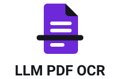
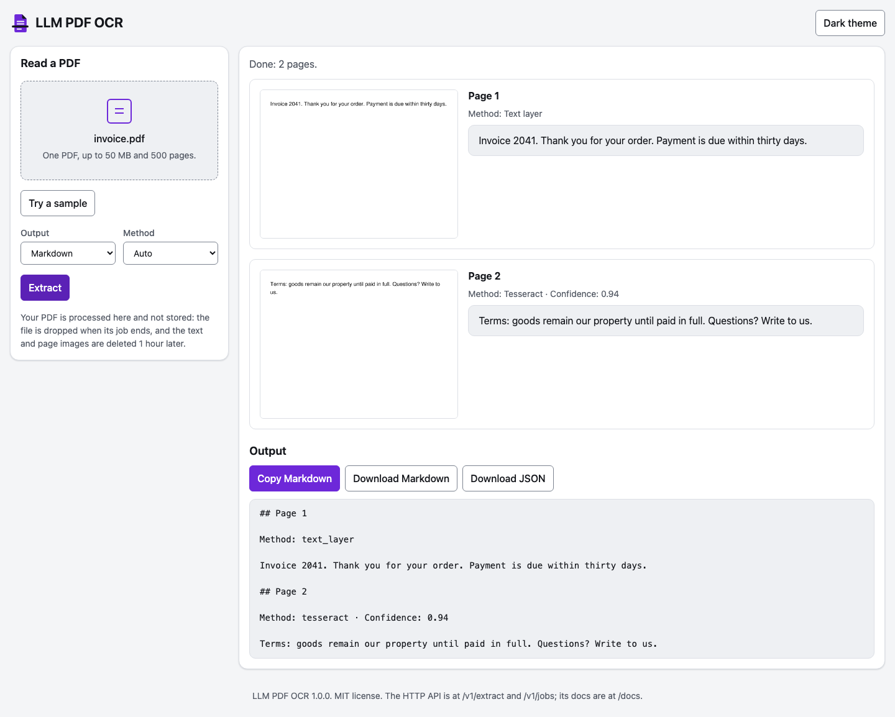
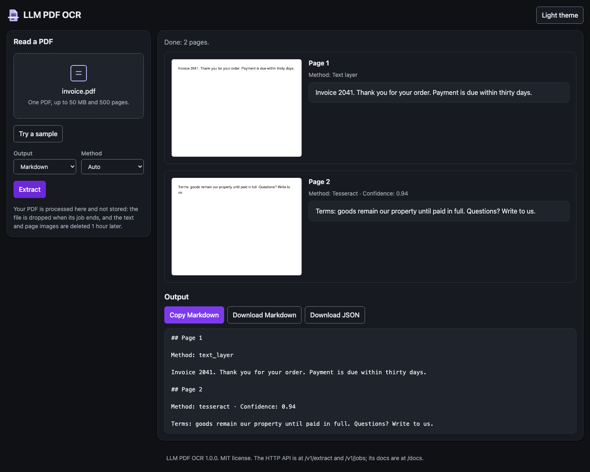
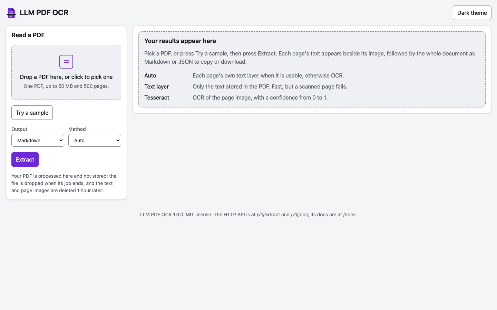
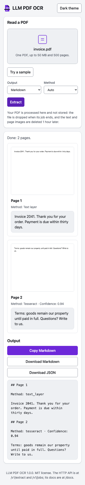
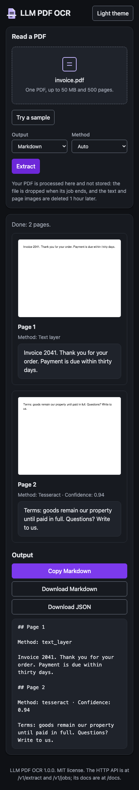

# llm-pdf-ocr-api

<p align="center">
  <picture>
    <source media="(prefers-color-scheme: dark)" srcset="docs/logo-dark.svg">
    
  </picture>
</p>

A small self-hosted FastAPI service, for anyone who needs the text out of PDFs, that reads a PDF page by page, scanned or not, and returns Markdown or JSON that says how each page was read.

<p>
  <a href="https://github.com/samestrin/llm-pdf-ocr-api/actions/workflows/ci.yml"></a>
  <a href="https://github.com/samestrin/llm-pdf-ocr-api/releases/latest"></a>
  <a href="LICENSE"></a>
</p>

## Demo







| Light, phone | Dark, phone |
| --- | --- |
|  |  |

The screenshots are made by `uv run python docs/make_screenshots.py`, with a stubbed jobs API, so they are the same on every machine.

## Why

- Running every page through OCR is slow and loses good text. Each page is read the cheapest way that works: `text_layer`, the PDF's own text, when it has a usable one; `tesseract`, OCR with Tesseract, for scanned pages, with a 0 to 1 confidence; or `vision`, a vision model you point it at (local or in the cloud), if you configure one.
- You need to know how far to trust each page. The response says which way each page was read.
- A blank page in the output hides a failure. A page that cannot be read is reported as `failed` with a reason; it is never returned as an empty page.
- Long PDFs time out a single request. They can run as jobs with per-page progress.
- Not every user has `curl` at hand. A web page at `/` reads a PDF from the browser, shows each page's image beside its text, and has a sample to try.

## Install

Run the published image (no GPU and no model download; Tesseract is inside):

```bash
docker run -p 5000:5000 ghcr.io/samestrin/llm-pdf-ocr-api
```

Or build it from this checkout and run that:

```bash
docker build -t llm-pdf-ocr-api .
docker run -d --name api -p 5000:5000 llm-pdf-ocr-api
```

`docker compose up` runs the same image, and `docker compose --profile vision up -d` adds a local Ollama server for the vision backend. To run without Docker, install [uv](https://docs.astral.sh/uv/) and Tesseract, then:

```bash
uv sync
uv run uvicorn llm_pdf_ocr.app:app --port 5000
```

## Quick start

On a fresh clone, with only Docker installed:

```bash
git clone https://github.com/samestrin/llm-pdf-ocr-api
cd llm-pdf-ocr-api
docker compose up --build
```

Open <http://localhost:5000> and press **Try a sample**, or drop in `tests/fixtures/born_digital.pdf`, a two-page PDF with a text layer. The pages show their text and say they were read by `text_layer`.

Or send the same file with `curl` from a second terminal:

```bash
curl -F file=@tests/fixtures/born_digital.pdf localhost:5000/v1/extract
```

```text
## Page 1

Method: text_layer

Quarterly Report

Left column first paragraph. Revenue grew in
every region this quarter, led by strong
demand for the new product line.
...
```

## Usage

| Endpoint | What it does |
| --- | --- |
| `POST /v1/extract` | Read a PDF page by page and return Markdown or JSON. Fields: `file`, `format`, `pages`, `method`, `model`. |
| `POST /v1/jobs`, then `GET /v1/jobs/{id}` | The same request as a job, for a long PDF: progress per page, then the result. |
| `GET /v1/jobs/{id}/pages/{n}.png` | A page the job read, as a PNG. |
| `GET /v1/capabilities` | The methods a request may use and the vision models it may pick. |
| `GET /` | The web page. |
| `GET /health` | Returns `{"status": "ok"}`. |
| `POST /ocr` | Deprecated alias kept for 0.0.1. Use `/v1/extract`. |

Interactive OpenAPI docs are served at `/docs` (schema at `/openapi.json`).

Read two pages as JSON:

```bash
curl -F file=@document.pdf -F format=json -F pages=1-2 localhost:5000/v1/extract
```

Run a long PDF as a job, then follow it:

```bash
curl -F file=@long.pdf -F format=json localhost:5000/v1/jobs
curl localhost:5000/v1/jobs/<id>
```

Every field, the job lifecycle and the error codes are in [docs/api.md](docs/api.md). The web page, its theme button, the sample and its screenshots are in [docs/web-page.md](docs/web-page.md).

## Configuration

Everything is an environment variable; none is required.

| Variable | Default | Meaning |
|---|---|---|
| `OCR_LLM_BASE_URL` | empty | Root of an OpenAI-compatible endpoint (ending in `/v1`). The vision backend is off while this is empty. |
| `OCR_LLM_DEFAULT_MODEL` | none | Vision model used when a request names none; required when `OCR_LLM_BASE_URL` is set. |
| `OCR_LLM_ALLOWED_MODELS` | the default model | Comma list of models a request may pick. |
| `OCR_LLM_API_KEY` | empty | Bearer key for the endpoint. |
| `OCR_LLM_TIMEOUT_SECONDS` | 60 | Per-request timeout to the vision endpoint. |
| `OCR_LLM_CONCURRENCY` | 2 | Vision requests in flight at once. |
| `OCR_LLM_FALLBACK_TO_TESSERACT` | false (true in `docker-compose.yml`) | Read a page with Tesseract when the vision model fails it. |
| `OCR_MAX_FILE_MB` | 50 | Largest upload; over it, 413 `file_too_large`. The web page states it. |
| `OCR_MAX_PAGES` | 500 | Most pages in one PDF; over it, 413 `too_many_pages`. The web page states it. |
| `OCR_PAGE_TIMEOUT_SECONDS` | 120 | Time allowed per page. |
| `OCR_JOB_TTL_SECONDS` | 3600 | How long a finished job's result is kept. The web page states it. |
| `OCR_MAX_JOBS` | 20 | Jobs held at once. |
| `OCR_MAX_IMAGE_MB` | 200 | Memory all held jobs may use for page images, together. Past it, a job still reads every page but renders no more images. |
| `OCR_WEB_PAGE` | true | Serve the web page at `/`. Set `false` for an API-only deployment: `/` and its files answer 404. |

Vision setup, with vLLM, Ollama and cloud examples, is in [Vision model backend](docs/vision-backend.md).

## Performance

Twenty freely licensed PDFs (born-digital, two-column, tables, forms, scans and poor scans) with reference text, in [`benchmarks/`](benchmarks/README.md). Results from `uv run python benchmarks/run.py`, in the run of 2026-11-03 with Tesseract 5.5.0, committed in [`benchmarks/results/2026-11-03.md`](benchmarks/results/2026-11-03.md) (raw results in [`2026-11-03.json`](benchmarks/results/2026-11-03.json)), which also has the per-document rows. The results file does not record the machine.

| Method | Text score (1 − CER) | Table F1 | Seconds per page | Failed pages |
|---|---:|---:|---:|---:|
| `text_layer` | 0.557 | 0.000 | 0.01 | 7 |
| `tesseract` | 0.702 | 0.000 | 2.43 | 0 |
| `vision` | not measured | not measured | not measured | not measured |

A document with a failed page scores 0, so `text_layer` is penalised for the seven scanned pages it cannot read (it fails them rather than guessing). Neither plain-text method recovers Markdown tables, so Table F1 is 0 for both. The vision row is empty because the committed run had no vision endpoint; it is filled in by running the benchmark with `OCR_LLM_BASE_URL` set.

To fill in the vision row, run it locally with Ollama:

```bash
docker compose --profile vision up -d
docker compose exec ollama ollama pull qwen2.5vl:7b
export OCR_LLM_BASE_URL=http://localhost:11434/v1
export OCR_LLM_DEFAULT_MODEL=qwen2.5vl:7b
export OCR_LLM_TIMEOUT_SECONDS=300
uv run python benchmarks/run.py
```

The row will name the endpoint (local Ollama) and the model (`qwen2.5vl:7b`). The result file records the model name only, never the endpoint URL or a key.

## How it works

1. The upload is checked against the limits while it arrives, and the selected pages are opened with PyMuPDF.
2. With `method=auto`, each page uses its text layer when it is usable, else the vision model if the operator configured one, else Tesseract.
3. Each page's result names its method (and its model or confidence); a page that fails carries an error code and message, and the other pages are still returned.
4. A job does the same in a background thread of the one process, and also renders each page as a PNG for the web page.

## Limits

- Jobs are held in the service's memory and run one at a time. Run a single uvicorn worker, as the Docker image does, and expect jobs to be lost on a restart.
- Uploads are limited to 50 MB and 500 pages by default (`OCR_MAX_FILE_MB`, `OCR_MAX_PAGES`); a page gets 120 seconds (`OCR_PAGE_TIMEOUT_SECONDS`).
- A finished job's result and page images are kept for 3600 seconds by default (`OCR_JOB_TTL_SECONDS`), then deleted; at most 20 jobs are held at once (`OCR_MAX_JOBS`).
- Neither `text_layer` nor `tesseract` recovers Markdown tables (Table F1 0 in the benchmark), and the vision row is not measured yet.
- There is no auth. Put an auth proxy in front before you expose it to a network you do not trust.
- The web page's copy button needs `localhost` or HTTPS, as the browser allows the clipboard only there.

## Documentation

- [docs/api.md](docs/api.md): every endpoint and field, jobs and page images, and the error codes
- [docs/web-page.md](docs/web-page.md): the web page, its theme, the sample, contrast and screenshots
- [docs/vision-backend.md](docs/vision-backend.md): the vision backend with vLLM, Ollama or a cloud endpoint
- [docs/upgrading-from-0.0.1.md](docs/upgrading-from-0.0.1.md): coming from the 0.0.1 Flask and TrOCR service
- [docs/deploy/embassy.md](docs/deploy/embassy.md): the owner's private review deploy (behind a login, no host port, no model server)
- [docs/release-notes-1.0.0.md](docs/release-notes-1.0.0.md): release notes for 1.0.0
- [benchmarks/README.md](benchmarks/README.md): the benchmark set and how each column is measured
- [VISION.md](VISION.md): what this project is and what it will become

## Development

```bash
uv sync
uv run playwright install chromium   # for the browser tests and the screenshots
uv run pytest                        # tests, with an 80% coverage gate
uv run ruff check . && uv run ruff format --check .
uv run python docs/make_screenshots.py
uv run python tests/fixtures/make_fixtures.py
```

The tests that read scanned pages need Tesseract installed. Contributions are welcome: fork the repository and open a pull request.

## Changelog

See [CHANGELOG.md](CHANGELOG.md).

## License

MIT; see [LICENSE](LICENSE).
