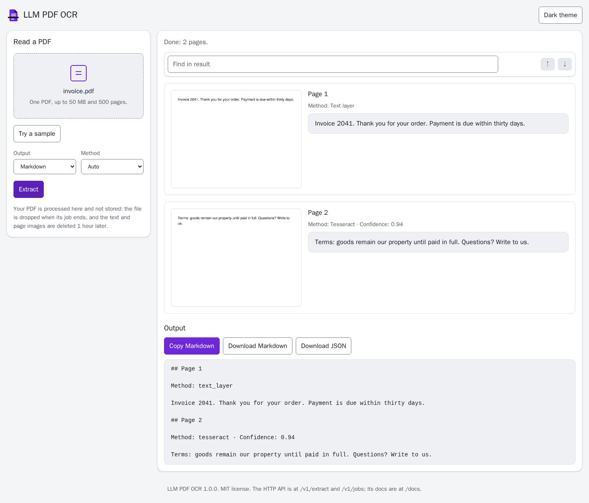
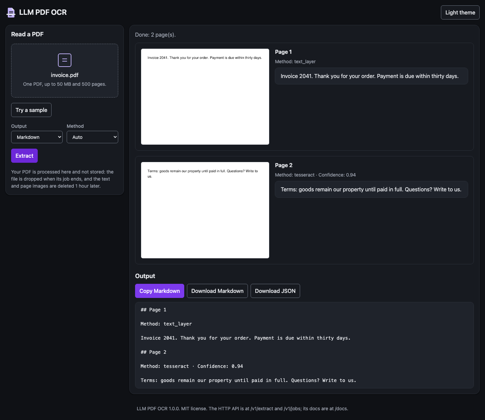
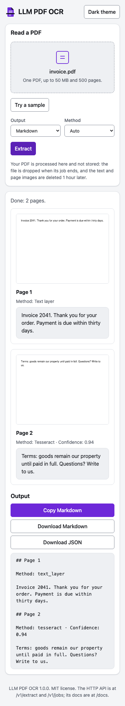
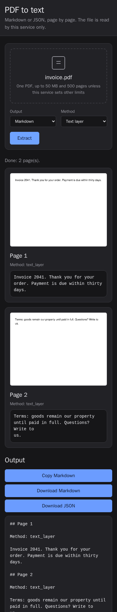

# The web page

**Endpoint:** `/` **Method:** GET

| Light | Dark |
| --- | --- |
|  |  |
|  |  |

A page to use the service from a browser: drop or pick a PDF, choose Markdown or JSON and a method, and follow the job's progress. The result shows each page's image as a thumbnail (at most 240 px tall; click it to open the page full size in a new tab) beside its text, the method that read it (named as in the Method menu: Text layer, Tesseract or Vision model), and why it failed if it did; the full Markdown or JSON follows. A find box above the result searches all of that text without sending anything to the server. The Markdown can be copied to the clipboard (which the browser allows on `localhost` or HTTPS), and the result downloaded as `result.md` or `result.json`. The page fits a phone-width screen, where each page's image sits above its text. Page text is shown as text, never as HTML, and a job that has expired is reported as an error.

## What is on the page

- The header names the app, LLM PDF OCR, with its mark, and has the theme button.
- The form states this service's real limits, filled in from `OCR_MAX_FILE_MB` and `OCR_MAX_PAGES` when the page is served (for example "One PDF, up to 50 MB and 500 pages."), and says what happens to your file: it is dropped when its job ends, and the text and page images are deleted `OCR_JOB_TTL_SECONDS` later (shown in words, such as "1 hour").
- **Try a sample** loads a small bundled PDF (`/static/samples/sample.pdf`, a copy of `tests/fixtures/mixed.pdf`, 15 KB) and reads it, so you can see a result without a file of your own. Its four pages show both routes: pages read from the text layer and scanned pages read by Tesseract.
- Before a file is chosen, the results panel says what you will see and explains each method in one line: Auto, Text layer, Tesseract and, when the operator configured one, Vision model.
- The footer links to the API reference at `/docs`.
- While a job runs, the status line says "Reading page 2 of 3" with three moving dots after it (just "Reading" until the job knows its pages), above a progress bar. A failure is shown as a red banner with the API's message and its request ID.
- Once a result is shown, a find box sits above the page cards and stays in reach while you scroll (see below).

## Find in the result

The find box searches each page's text and the whole Markdown or JSON output, whichever is shown. The query is plain text, matched literally (never as a regular expression) and case-insensitively. Every match is highlighted in amber; the current match wears the violet accent. The count beside the box reads "3 of 12", or "No matches" when there are none.

- **Enter** or the **↓** button moves to the next match; **Shift+Enter** or the **↑** button to the previous one. Stepping wraps around at either end, scrolls the match into view, and opens its page if it is collapsed.
- **Escape** clears the box and every highlight.
- Everything happens in the browser: typing, counting and stepping never send a request. Typing is debounced (150 ms) and each text is scanned in one pass, so a 500-page result keeps up; `tests/test_browser.py` measures the highlight pass against a 200 ms budget.

## Theme

The page follows the browser's light or dark theme. The theme button in the header overrides it; its label names what a click does ("Dark theme" or "Light theme"), and the choice is saved in the browser (`localStorage`, key `theme`). With no saved choice, the page follows the system again. People who ask for reduced motion see no animation.

## Look

The page shares one design system with the owner's other demo apps, taken from llm-pdf-chatbot: the same type, spacing, radii, surfaces, focus ring and controls, with this app's own violet accent and page-and-scan mark. Every text colour passes WCAG AA (4.5:1) in both themes; `tests/test_browser.py` measures them in a real browser. The accent pairs:

| Pair | Light | Dark |
| --- | --- | --- |
| Accent on the surface | `#6D28D9` on `#FFFFFF`: 7.10 | `#C4B5FD` on `#171A20`: 9.44 |
| Accent on the page background | `#6D28D9` on `#F4F5F7`: 6.51 | `#C4B5FD` on `#0F1115`: 10.24 |
| Accent on its subtle fill | `#6D28D9` on `#F1ECFD`: 6.14 | `#C4B5FD` on `#2A2140`: 8.18 |
| Accent hover on the surface | `#5B21B6` on `#FFFFFF`: 8.98 | `#DDD6FE` on `#2A2140`: 10.88 |
| White on the primary button | `#FFFFFF` on `#6D28D9`: 7.10 | `#FFFFFF` on `#7C3AED`: 5.70 |

## How it is built

It is plain HTML, CSS and JavaScript shipped inside the package (`src/llm_pdf_ocr/web/`, no build step), served with `Content-Security-Policy: default-src 'self'`, and loads nothing from any other origin, so it works with no network. For an API-only deployment, set `OCR_WEB_PAGE=false`: `/`, `/docs` and the page's files then answer 404, and every API endpoint works as before.

The API reference at `/docs` is part of the same family: Scalar, vendored in `src/llm_pdf_ocr/web/scalar/` at a pinned version, reading this service's own `/openapi.json`, with the same violet accent and the same favicon. Its policy is `default-src 'self'; style-src 'self' 'unsafe-inline'` — Scalar injects its own stylesheets while it draws the page — and its configuration turns off Scalar's request proxy, web fonts, telemetry and "open in client" button, so "try it" calls this service directly and the page works with no network. FastAPI's own docs pages and ReDoc are off; `/redoc` answers 404.

## Screenshots

The screenshots here and in the README are made by one command, from the repository root:

```bash
uv run python docs/make_screenshots.py
```

It serves the real page and stubs the jobs API in the browser with a fixed two-page result, so the images are the same on every machine and need neither Tesseract nor a model. It writes the four images above and `screenshot-web-page-empty-light-desktop.png`, the page before a file is chosen.

## Demo GIF

The README's demo GIF is a recording of one real session, made from the repository root:

```bash
uv run python docs/make_demo_gif.py
```

It needs Tesseract (the sample's scanned pages are read by it) and chromium (`uv run playwright install chromium`). The app starts on an ephemeral `127.0.0.1` port and nothing is stubbed: the script presses **Try a sample**, waits for the job to finish, shows a page read from the text layer and a page read by Tesseract with its confidence, types in the find box and steps through three matches, then opens the API reference at `/docs` and its `POST /v1/extract` section.

Each step is saved as a 1280x800 PNG (`docs/demo-frame-NN-*.png`, not committed); any other size is refused. Pillow stitches the frames into `docs/demo-web-page.gif`, which the script reopens and checks: it must animate, every frame must be 1280x800, and it must run under 30 seconds (eight frames at 2.5 s each, so 20 s).

An operator who runs their own instance can record that one instead with `LIVE_URL=https://their-instance uv run python docs/make_demo_gif.py`. There is no default URL: with `LIVE_URL` unset the script only ever talks to the app it started itself.

The recording is not part of `uv run pytest`. The tests check the guards (a mixed-size frame set, a still or over-long or wrong-size GIF) and the committed GIF and its alt text.
